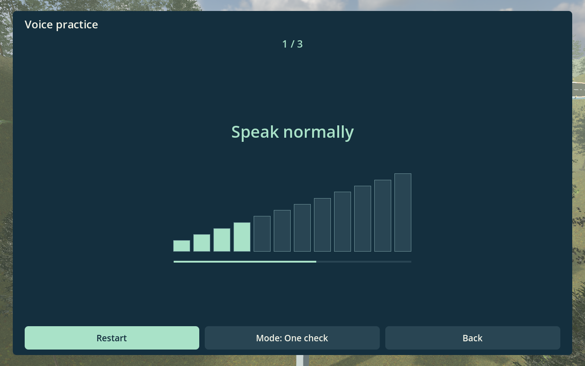
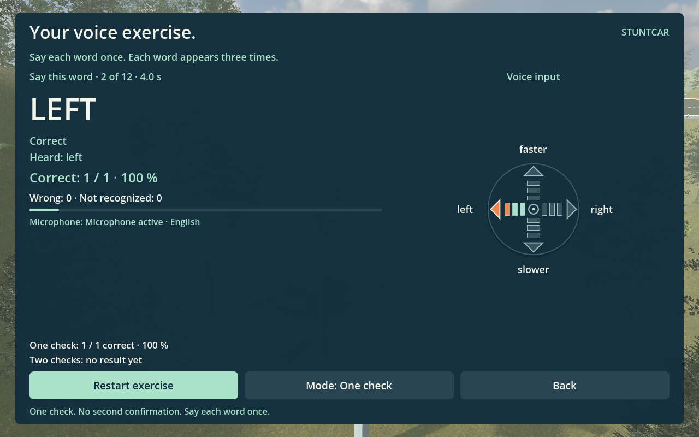

# Stuntcar · Erste Fahrt

Ein erster Prototyp mit Godot 4.5.1. Das Spiel verwendet eigene Strecken und kostenlose 3D-Modelle.

Das Auto und der Asphalt aus der Qualitätsprobe stehen auf allen vier Strecken bereit.
Die Strecke „Erste Fahrt“ führt durch einen Wald mit Tannen, Kiefern und bewachsenen Hängen.
Moosige Felsen, Farne und Gras ergänzen den Waldboden.
Die Alpen verwenden weiterhin die Kiefern aus der Probe.
Das Spiel verwendet jetzt den Grafikmodus Forward+ für Licht, Reflexionen und Schatten.
Die Steuerung, die Sprünge und die Steilkurven bleiben erhalten.
Die übrigen Landschaften verwenden weiterhin das erste Paket.
Die Quellen und Nutzungsrechte stehen in [assets/quality/README.md](assets/quality/README.md).
Die zusätzlichen Waldmodelle stehen unter der Lizenz CC0. Ihre Quellen stehen in [assets/forest/README.md](assets/forest/README.md).

Das Spiel enthält vier Strecken mit dem neuen Auto und vier Landschaften:

| Strecke | Länge | Inhalt | Dauer bei normalem Tempo |
|---|---|---|---|
| Erste Fahrt | 940 m | Wald, zwei große Sprünge und drei Steilkurven | etwa 43 Sekunden |
| Höhenfahrt | 1250 m | Alpenpass, fünf Kurven und ein Sprung | etwa 57 Sekunden |
| Sprungstrecke | 1350 m | Felsenschlucht, fünf Kurven und zwei Sprünge | etwa 62 Sekunden |
| Küstenfahrt | 600 m | Regenküste, drei Kurven und eine Kuppe | etwa 27 Sekunden |

Das Auto startet mit etwa 79 km/h. Mit Sprache kannst du das Tempo ändern. Eine laute Vollbremsung hält das Auto an. Mit „faster“ fährt es wieder an. Die Sprünge brauchen keine zusätzliche Taste.

## Start auf diesem Mac

1. Öffne `Starten.command` im Finder mit einem Doppelklick.
2. Wähle eine Strecke anhand der Vorschaubilder.
3. Nutze A für den nächsten Eintrag und D für die Auswahl. Du kannst auch klicken.
4. Wähle beim ersten Start danach „Two keys“ oder „Voice + keys“.
5. Wähle „Start drive“.
6. Drücke vor der Kurve einmal die passende Richtungstaste.

Bei jedem Start erscheint zuerst die Streckenauswahl. Das Spiel merkt sich die letzte Strecke und die Steuerung. Bei späteren Starts brauchst du die Steuerung nicht erneut zu wählen. Unter „Settings → Controls“ kannst du die Steuerung jederzeit ändern. Die Tasten bleiben auch bei Sprache verfügbar.

Im Hauptordner startet nur `Starten.command` das Spiel.
Die weiteren Werkzeuge liegen unter `tools/macos/`.
Die Übersicht steht in [tools/macos/README.md](tools/macos/README.md).

Godot liegt für diesen Mac im Projektordner `.tools`. Das Spiel braucht keine Internetverbindung.

Für Änderungen öffne `project.godot` mit Godot 4.5.1. Starte das Projekt dort mit F5.

Auf einem anderen Rechner brauchst du Godot. Importiere dort `project.godot`. Die Datei `Starten.command` gilt nur für macOS.

## Die Tasten

| Zustand | A | D |
|---|---|---|
| Fahrt | Links lenken | Rechts lenken |
| Menü | Nächsten Eintrag wählen | Den Eintrag öffnen |

Du musst keine Taste halten. Gehaltene Tasten erzeugen keine weiteren Befehle. Gleichzeitige Tastendrücke erzeugen keinen Lenkbefehl.

Ein erneuter Druck auf dieselbe Richtungstaste korrigiert weiter. Er pausiert die Fahrt nicht. Escape und der Sprachbefehl „Pause“ pausieren die Fahrt bewusst.

Im Pausenmenü setzt D die Fahrt fort. A wählt zum Beispiel „Restart“ aus. D startet dann neu.

Beim Wechsel zu einem anderen Fenster pausiert das Spiel.

## Deine Richtung zählt

Das Auto beschleunigt selbstständig. Ohne Eingabe fährt es geradeaus. In einer Kurve fährt es dann über den Rand.

Ein Hinweis zeigt die nächste Richtung. Eine passende Eingabe aktiviert die Lenkhilfe für diese eine Kurve. Die Lenkhilfe übernimmt die Genauigkeit.

In der Kurve kommt das Auto nahe an den äußeren Rand. Ein weiterer passender Tastendruck zieht es nach innen. Dafür musst du keine Taste halten.

Nach der Kurve endet die Lenkhilfe. Die nächste Kurve braucht eine neue Eingabe. Eine falsche Eingabe lenkt tatsächlich in die falsche Richtung.

Eine spätere Eingabe lässt weniger Platz für die Korrektur. Die Lenkhilfe kann nicht jede Lage retten.

Nach einem Fall startet das Auto selbstständig auf der Geraden vor der Kurve. Es fährt sofort mit vollem Tempo weiter. Es gibt kein Bestätigungsmenü. Das Spiel hat keine Zeitgrenze.

## Die Einstellungen

- Wähle drei, fünf oder acht Sekunden Vorlauf für den Hinweis.
- Schalte den Hinweiston ein oder aus.
- Weise zwei andere Tasten zu.

Die neue Tastenbelegung gilt erst nach zwei verschiedenen Zuordnungen. Ohne Eingabe bricht die Zuordnung nach 30 Sekunden ab. Die alten Tasten bleiben dann erhalten.

Godot speichert die Einstellungen im eigenen Benutzerdatenordner. Das Spiel zeichnet keine Eingaben auf.

## Sprache der Oberfläche

Das Spiel zeigt seine Menüs, Fahrhinweise, Streckentexte und Fehlermeldungen auf Englisch. Die Texte liegen in `locales/en.po`. Godot lädt diese Datei direkt. Die Anleitung für weitere Sprachen steht in [locales/README.md](locales/README.md). Die Sprache der Oberfläche ändert die Erkennung der Sprachbefehle nicht.

## Mit Sprache spielen

1. Öffne `Starten.command` und wähle eine Strecke. Wähle danach beim ersten Start „Voice + keys“.
2. Erlaube den Mikrofonzugriff, falls macOS danach fragt.
3. Warte auf „Microphone active · English“ am unteren Rand.
4. Sage „Start“.

Du kannst die Sprache unter „Settings → Controls“ einschalten. Wähle dort „Voice + keys“. Im Pausenmenü findest du die Steuerung auch direkt.

Die Spracheingabe nutzt das Standardmikrofon des Macs. Wähle bei Bedarf unter „Systemeinstellungen → Ton → Eingabe“ ein anderes Mikrofon.

| Wirkung | Englischer Befehl |
|---|---|
| Links korrigieren | left |
| Rechts korrigieren | right |
| Tempo erhöhen | faster, fast, gas, accelerate, throttle |
| Tempo senken | slower, brake, brakes |
| Fahrt pausieren | pause |
| Fahrt fortsetzen | continue, resume |
| Fahrt starten | start |
| Nächsten Menüeintrag wählen | next |
| Menüeintrag öffnen | select |

Die Spracheingabe erkennt jetzt Englisch. Deutsche Sprachbefehle entfallen vorerst. Die Oberfläche erscheint auf Englisch.

Du kannst „left left left left left“ direkt hintereinander sagen. Ein gesprochenes Wort genügt für einen Befehl. Der neue Standard nutzt einen Erkenner ohne zusätzliche Bestätigung. Die Einstellung „Two checks“ nutzt zwei Erkenner für dieselbe Äußerung. Sie verlangt kein zweites gesprochenes Wort.

Die Ergebnisse „fasta“ und „foster“ gelten ebenfalls als „faster“. Bei anderen unbekannten Fahrwörtern erlaubt der Vergleich höchstens ein anderes, fehlendes oder zusätzliches Zeichen. Der Treffer muss eindeutig zu einem Fahrbefehl passen. „Fast“ und „faster“ gelten als ein Fahrbefehl. Menübefehle bleiben exakt. Der Vergleich ersetzt keine vollständigen fremden Sätze durch einen Befehl.

Der Vergleich ergänzt keine Wartezeit. Der technische Nachweis steht in `docs/levenshtein-command-check.txt`. Beide Modi geben Fahrbefehle bereits während des Sprechens weiter. Menüs warten auf das Ende der Äußerung.

Ein erneut gesprochenes „left“ oder „right“ korrigiert erneut. Die Lautstärke bestimmt die Stärke der Korrektur. Die Tasten nutzen weiter die normale Stärke.

Die drei Balken bestimmen die Wirkung eines bestätigten Fahrbefehls:

| Balken | Wirkung | Änderung des Zieltempos |
| --- | --- | --- |
| 1 | Kleine Lenkkorrektur, schwache Beschleunigung oder Bremse | rund 7 km/h |
| 2 | Normale Lenkkorrektur, Beschleunigung oder Bremse | 18 km/h |
| 3 | Große Lenkkorrektur, starke Beschleunigung oder Bremse | rund 29 km/h |

„Faster“ erhöht das Zieltempo. „Slower“ senkt das Zieltempo. Wiederholte Befehle zählen einzeln. Die tatsächliche Geschwindigkeit folgt dem Zieltempo. Ein lauter Befehl verändert sie schneller. Eine Lenkbewegung auf der Geraden dauert jeweils 0,3 Sekunden. Leise Befehle ändern dabei die Richtung um etwa 3 Grad. Normale Befehle ändern sie um 7,5 Grad. Laute Befehle ändern sie um 12 Grad. In Kurven und vor Sprüngen skaliert die Korrekturhilfe ihre Wirkung entsprechend.

Zum Beispiel erhöht ein normal gesprochenes „faster, faster“ das Zieltempo von 79 auf 115 km/h. „Slower, slower“ senkt es wieder auf 79 km/h. Die Anzeige zeigt das aktuelle Tempo und das Zieltempo.

Bei hohem Tempo kommt das Auto stärker an den äußeren Kurvenrand. Eine weitere kurze Korrektur zieht es wieder nach innen. Alternativ kannst du vor der Kurve langsamer fahren. Die Kamera erweitert bei hohem Tempo den Blick. Der Horizont bleibt ruhig.

Der Bereich reicht von etwa 50 bis 166 km/h. „Slower“ hält das Auto nicht an. Für eine bewusste Pause drücke Escape. Im Modus „Two checks“ kannst du auch „pause“ sagen.

Bei einem erneuten Versuch startet das Auto wieder mit etwa 79 km/h.

Die Sprachfahrt zeigt ein Pfeilkreuz rechts neben der Strecke. Links und rechts zeigen die Lenkrichtung. Der obere Pfeil steht für Beschleunigen. Der untere Pfeil steht für Bremsen. Er steht nicht für eine Rückwärtsfahrt.

Jeder Pfeil enthält drei Balken. Ein leiser Befehl füllt einen Balken. Ein mittlerer Befehl füllt zwei Balken. Ein lauter Befehl füllt drei Balken. Die Pfeilspitze leuchtet erst, wenn das Spiel den Befehl übernimmt. Solange die Spitze leuchtet, zeigen die Balken die übernommene Stärke. Ein neuer Livepegel verändert diese Bestätigung nicht. Wiederholte Wörter bestätigen den Pfeil erneut. Die Anzeige klingt danach ab. Erkannte Wörter erscheinen nicht als Text.

Die Balken und die Steuerung nutzen dieselben drei Pegelstufen. Das Spiel nutzt die Stärke des bestätigten Befehls. Die laufende Pegelanzeige allein steuert das Auto nicht. Die Messung nutzt die stärksten Signalabschnitte der letzten 450 Millisekunden. Sie misst keinen absoluten Schalldruck. Der Abstand zum Mikrofon und die Mikrofoneinstellung beeinflussen die Anzeige. Die persönliche Kalibrierung unter „Settings → Voice practice“ ersetzt die festen Pegelgrenzen. Ohne gültige Kalibrierung nutzt das Spiel weiter die bisherigen Grenzen. Normales Sprechen genügt für den Versuch. Stark gedehnte Wörter können die Erkennung erschweren.

Die Erkennung verarbeitet intern kürzere Audioabschnitte. Der Vergleich mit der bisherigen Erkennung steht in `docs/vosk-english-vergleich.txt`. Die Messwerte stehen in `docs/vosk-english-latency.json`.

Fahrbefehle verändern kein Menü. Nutze dort „next“ und „select“. Sprache und Tasten bleiben gleichzeitig verfügbar.

## Die Sprachübung

Öffne „Settings → Voice practice“. Wähle „Calibrate voice“. Sage zuerst „okay“ mit deiner normalen Stimme. Sage „okay“ danach lauter. Sage „okay“ zuletzt sehr laut. Mache nach jedem Wort eine kurze Pause.

Die Balken steigen von links nach rechts an.

Die Anzeige passt ihren Maßstab an die normale Stimme an. Der normale Pegel füllt ungefähr ein Drittel der Balken. Die Bestätigung behält diesen Pegel bei. Die zweite gespeicherte Stufe füllt zwei Drittel. Erst die dritte gespeicherte Stufe füllt alle Balken.

Wenn die erste Messung den bisherigen Maßstab überschreitet, passt die Anzeige die Empfindlichkeit an. Danach fordert sie erneut zum normalen Sprechen auf. Ein übersteuerter Mikrofoneingang löst eine Aufforderung zum leiseren Eingang aus. Diese Messung zählt nicht. Die gespeicherten Werte bleiben bis zum erfolgreichen Abschluss erhalten.

Die Balken zeigen den Mikrofonpegel im persönlichen Maßstab. Die kurze Linie darunter zeigt den Fortschritt der Aufnahme. Jede Stufe braucht mehrere kurze Pegelmessungen. Die Stufe zählt erst am Wortende.

Ein abgeschlossenes kurzes Wort genügt ab zwei gültigen Messungen. Ein zu kurzes Wort fordert zur Wiederholung auf. Eine kurze Bestätigung trennt die Stufen. Bei fast gleichen Pegeln fordert die Seite zum lauteren Sprechen auf.

Das Spiel speichert erst nach allen drei Stufen ein neues Profil. Ein Abbruch behält das bisherige Profil. Das Profil gehört zum Namen des Mikrofons. Ein anderes Mikrofon verwendet die bisherigen festen Grenzen.

Die drei persönlichen Stufen entsprechen einem, zwei und drei Balken. Sie bestimmen auch die Stärke beim Lenken, Beschleunigen und Bremsen. Das Spiel speichert keine Tonaufnahme.



Nach der Kalibrierung beginnt automatisch die Wortübung. Sage das angezeigte Wort jeweils einmal. Die Übung fragt „left“, „right“, „fast“ und „slower“ jeweils dreimal ab. Das Wort steht direkt am passenden Pfeil.

Für jeden Versuch bleiben vier Sekunden. Nach jeder Antwort blendet das Wort aus. Die kurze Pause dauert 0,8 Sekunden. Danach blendet die nächste Aufforderung ein. Die Pause nimmt keine weiteren Antworten an.

Das Pfeilkreuz bestätigt den erkannten Fahrbefehl. Ein Haken zeigt eine richtige Antwort. Ein Kreuz zeigt eine falsche oder nicht erkannte Antwort. Während der Übung erscheint nur das gefragte Wort mit der Versuchsnummer. Die ausführliche Trefferzahl erscheint am Ende.

Sie zählt falsche Befehle und nicht erkannte Antworten getrennt. Eine fehlende Antwort zählt nach vier Sekunden als nicht erkannt. Der Prozentwert gilt für diese Übungsrunde.

Die Taste „Mode“ wechselt zwischen einem Erkenner und zwei Erkennern. Die Seite behält das letzte Ergebnis beider Modi bis zum Spielende. Eine neue Runde ersetzt das Ergebnis ihres Modus. Die Moduswahl gilt auch für die Fahrt. Das Spiel speichert diese Wahl.

Die Übung prüft deine Stimme. Sie verändert das Sprachmodell nicht. Sie speichert keine Tonaufnahme. Die Übung greift auch mit der Tastensteuerung auf das Mikrofon zu. Beim Verlassen beendet sie diesen zusätzlichen Zugriff. Escape führt zurück zu den Einstellungen.



Der Zeitvergleich steht in `docs/voice-direct-comparison.txt`. Er nutzt künstliche Tonproben. Er ersetzt keine Messung mit deinem Mikrofon. Der einzelne Erkenner erkennt in diesen Proben „brake“ und „pause“ nicht zuverlässig. Nutze „slower“ und Escape. Für den Vergleich bleibt „Two checks“ verfügbar.

## Mikrofon und Einrichtung

Das Spiel startet die Spracheingabe nach der Wahl „Voice + keys“. Es speichert diese Wahl für den nächsten Start. Die Wahl „Two keys“ beendet den Mikrofonzugriff.

Das Spiel speichert die Steuerung, die Tasten, die Strecke, die Tonlautstärken und die persönliche Sprachkalibrierung.
Beim normalen Start nutzt es die gespeicherten Werte.
Du musst die Kalibrierung nicht bei jedem Start wiederholen.
Unter „Settings → Voice practice“ kannst du sie bei Bedarf neu durchführen.

Die Erkennung läuft lokal mit Vosk. Sie sendet keine Tonaufnahmen ins Internet. Sie speichert keine Mikrofonaufnahmen.

Auf diesem Mac sind die Bibliotheken und Sprachmodelle bereits eingerichtet. Ein anderer Mac braucht einmalig Python 3.11 oder neuer. Öffne dort `tools/macos/Sprache einrichten.command`. Diese Einrichtung braucht eine Internetverbindung. Danach funktioniert die Sprachsteuerung ohne Internet.

Die Einrichtung lädt nur das englische Modell. Alte zweisprachige Vergleichstests brauchen zusätzlich das deutsche Modell. `python3 voice/setup.py --with-german` richtet auch dieses Modell ein.

Die Sprachmodelle liegen unter `.tools/voice-models`. Die Hilfsprogramme liegen unter `.tools/voice-env`. Diese lokalen Dateien gehören nicht zum Spielcode.

Falls das Mikrofon fehlt, prüfe „Systemeinstellungen → Datenschutz & Sicherheit → Mikrofon“. Erlaube dort den Zugriff für die angezeigte Anwendung. Starte das Spiel danach erneut.

Bei einem Mikrofonfehler pausiert eine aktive Fahrt. Die Tasten bleiben verfügbar. Wähle unter „Controls“ erneut „Voice + keys“. Setze die Fahrt danach bewusst mit „resume“ oder D fort.

Die künstlichen Sprachproben prüfen die Erkennung technisch. Die neue Erkennung braucht noch einen Test mit deiner Stimme. Hintergrundgeräusche und die Aussprache können das Ergebnis verändern.

## Stand und nächste Schritte

Dieser Prototyp enthält vier Strecken, Sprünge, Tastensteuerung, Sprachsteuerung und die Tempowahl per Sprache. Loopings fehlen noch.

Vor einem Sprung zeigt das Spiel eine nötige Korrektur an. Ein kurzer Druck zur Mitte richtet das Auto für die Landung aus. Das funktioniert auch noch während des Sprungs und kurz nach der Landung. Die Hilfe endet nach der Landung. Eine spätere Kurve braucht wieder deine Eingabe.

Der Flug folgt einem vorgegebenen Bogen. So reicht jedes erlaubte Tempo für die Lücke. Das Auto hebt sichtbar ab und federt bei der Landung kurz ein. Die Kamera zeigt die Abfahrt und hält die Landung im Blick.

Die Kurven haben eine geneigte Fahrbahn. Die Waldstrecke enthält Steilkurven mit 38, 45 und 42 Grad Neigung. Zwei Rampen führen über jeweils 50 Meter breite Lücken. Beim normalen Tempo dauert jeder Flug etwa 2,3 Sekunden. Das Auto erreicht rund 70 Meter Höhe über dem Nullpunkt der Spielwelt. Der Wald bleibt unten im Tal. Das Auto folgt der Neigung. Absprung und Landung bleiben quer zur Fahrbahn eben.

Weitere Strecken entstehen aus `tracks/templates/strecke.json`. Jede Strecke ist eine eigene Textdatei mit einem Namen. Du kannst Dateien hinzufügen oder entfernen. `tools/macos/Strecken prüfen.command` prüft die Dateien mit einem Doppelklick. Die Anleitung steht in [tracks/README.md](tracks/README.md). Das Spiel nimmt gültige Streckendateien beim nächsten Start automatisch in die Auswahl auf.

Die Tests prüfen die Spielregeln und die Fahrzeugbewegung. Sie belegen noch nicht das Spielgefühl für Menschen mit körperlichen Einschränkungen.

Bei einem gemeinsamen Spieltest prüfen wir besonders die Spannung, den Hinweisvorlauf und die Wirkung der kurzen Korrekturen.

Die Kamera folgt dem Auto tief über der Strecke. Die Kamera bleibt ruhig. Das Auto neigt sich am Rand leicht nach außen. Markierungen am Rand machen das Tempo sichtbar.

Die Prüfergebnisse stehen in `docs/prototype-test.md`. Der ursprüngliche Plan steht unter `docs/superpowers/plans`.

## Automatische Prüfungen

Führe diese Aufrufe im Projektordner aus:

```sh
.tools/Godot.app/Contents/MacOS/Godot --headless --path . --script tests/run_tests.gd
.tools/Godot.app/Contents/MacOS/Godot --headless --path . --script tests/run_input_tests.gd
.tools/Godot.app/Contents/MacOS/Godot --headless --path . --script tests/run_tension_tests.gd
.tools/Godot.app/Contents/MacOS/Godot --headless --fixed-fps 60 --path . --script tests/run_scene_test.gd
.tools/Godot.app/Contents/MacOS/Godot --headless --path . --script tests/run_voice_tests.gd
.tools/Godot.app/Contents/MacOS/Godot --headless --path . --script tests/run_voice_bridge_tests.gd
.tools/Godot.app/Contents/MacOS/Godot --headless --path . --script tests/run_voice_scene_tests.gd
.tools/Godot.app/Contents/MacOS/Godot --headless --path . --script tests/run_voice_compass_tests.gd
.tools/Godot.app/Contents/MacOS/Godot --headless --path . --script tests/run_voice_strength_tests.gd
.tools/Godot.app/Contents/MacOS/Godot --headless --path . --script tests/run_voice_practice_tests.gd
.tools/Godot.app/Contents/MacOS/Godot --headless --path . --script tests/run_voice_practice_cues_tests.gd
.tools/Godot.app/Contents/MacOS/Godot --headless --path . --script tests/run_voice_calibration_tests.gd
.tools/Godot.app/Contents/MacOS/Godot --headless --path . --script tests/run_voice_auto_range_tests.gd
.tools/Godot.app/Contents/MacOS/Godot --headless --path . --script tests/run_voice_calibration_scene_tests.gd
.tools/Godot.app/Contents/MacOS/Godot --headless --path . --script tests/run_voice_practice_scene_tests.gd
.tools/Godot.app/Contents/MacOS/Godot --headless --path . --script tests/run_speed_bank_tests.gd
.tools/Godot.app/Contents/MacOS/Godot --headless --path . --script tests/run_track_tests.gd
.tools/Godot.app/Contents/MacOS/Godot --headless --path . --script tests/run_selection_tests.gd
.tools/Godot.app/Contents/MacOS/Godot --headless --path . --script tests/run_jump_scene_tests.gd
.tools/Godot.app/Contents/MacOS/Godot --headless --path . --script tests/run_catalog_tests.gd
.tools/Godot.app/Contents/MacOS/Godot --headless --path . --script tests/run_landscape_tests.gd
.tools/Godot.app/Contents/MacOS/Godot --headless --path . --script tests/run_forest_tests.gd
.tools/Godot.app/Contents/MacOS/Godot --headless --fixed-fps 60 --path . --script tests/run_forest_fall_test.gd
.tools/Godot.app/Contents/MacOS/Godot --headless --path . --script tests/run_stunt_track_tests.gd
.tools/voice-env/bin/python -m unittest discover -s voice/tests
```

`tests/measure_voice_latency.gd` misst eine künstliche Wortfolge bis zum ausgeführten Befehl. Der Test ersetzt nur die Mikrofonquelle. Er speichert keine Mikrofonaufnahmen.

`tests/capture_preview.gd` erstellt Bilder der tatsächlichen Spielansicht. Dieser Aufruf braucht ein Fenster.

## Quellen der Sprachsteuerung

- [Vosk-Sprachmodelle](https://alphacephei.com/vosk/models): Kleine deutsche und englische Modelle 0.15. Beide nutzen die Lizenz Apache 2.0.
- [Vosk](https://alphacephei.com/vosk/install): Lokale Spracherkennung.
- [sounddevice](https://python-sounddevice.readthedocs.io/en/latest/installation.html): Zugriff auf das Mikrofon.

## Spielton

Der Motor folgt der Geschwindigkeit. Im Flug endet das Rollgeräusch.
Die Landung erzeugt einen kurzen Stoß. Auf der Waldstrecke laufen leise Waldgeräusche.

Unter „Einstellungen → Lautstärke“ lassen sich Motor, Umgebung und Hinweise getrennt einstellen.
„Ton: Aus“ schaltet alle Spielgeräusche aus.
Die Quellen und die Bearbeitung stehen in [assets/audio/README.md](assets/audio/README.md).
Der Motorton stammt von qubodup und nutzt CC BY 3.0.
Die Namensnennung in [assets/audio/CREDITS.txt](assets/audio/CREDITS.txt) muss der Weitergabe des Spiels beiliegen.
Die Aufnahme [docs/tonprobe.wav](docs/tonprobe.wav) zeigt eine Fahrt mit einem Sprung.

Zusätzlicher Tontest:

```sh
.tools/Godot.app/Contents/MacOS/Godot --headless --path . --script tests/run_audio_tests.gd
```

Der dynamische Motorton reagiert auf Gasgeben, Gaswegnehmen, Gangwechsel, Rampen und Sprünge.
Eine zusätzliche Hörprobe steht unter [docs/motor-dynamisch.wav](docs/motor-dynamisch.wav).
Der Test `tests/run_engine_audio_tests.gd` prüft die berechnete Drehzahl und den erzeugten Klanganteil.
