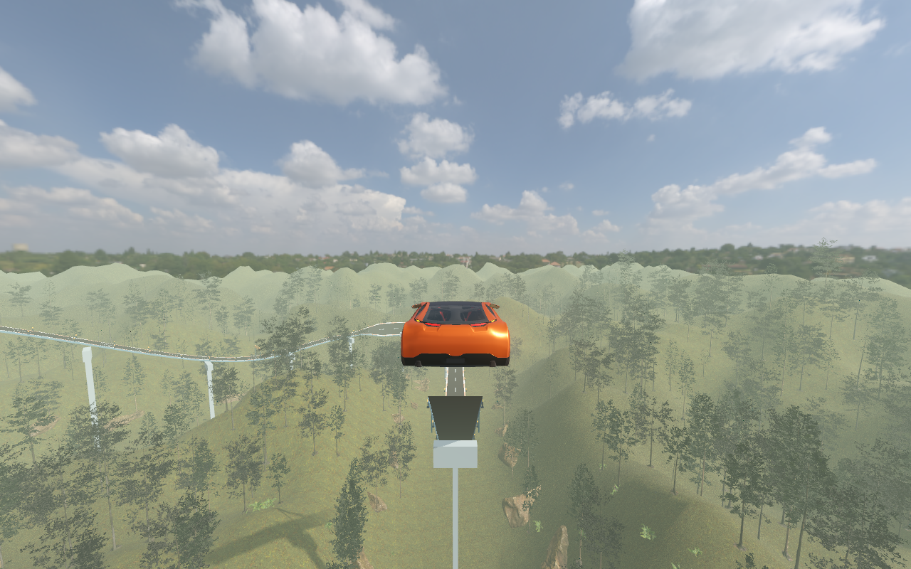
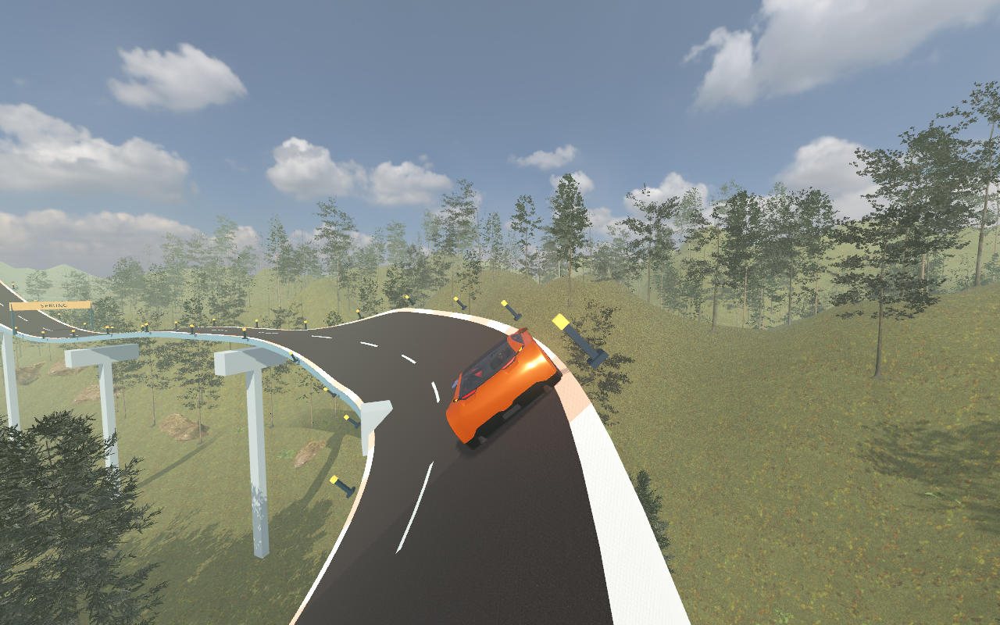

# Stuntstrecke im Wald

Die Strecke „Erste Fahrt“ hat jetzt 940 Meter Länge.
Der Wald behält sein bisheriges Aussehen.
Die Fahrbahn steigt deutlich über die Baumkronen.

| Abschnitt | Änderung |
|---|---|
| Erste Kurve | 38 Grad Neigung |
| Erster Sprung | 50 Meter Lücke nach einer hohen Rampe |
| Zweite Kurve | 45 Grad Neigung |
| Zweiter Sprung | 50 Meter Lücke mit anschließender Abfahrt |
| Dritte Kurve | 42 Grad Neigung |

Beim normalen Tempo von etwa 79 km/h dauert jeder Flug ungefähr 2,3 Sekunden.
Die vollständige Fahrt dauert etwa 43 Sekunden.
Das Auto erreicht beim ersten Sprung 69,7 Meter Höhe über dem Nullpunkt der Spielwelt.
Der Boden unter der Flugbahn liegt etwa 4,5 Meter hoch.
Die Flugbahn bleibt geführt. Kurze Richtungseingaben reichen weiter für die Fahrt.

Der Wald steigt unter den Rampen nicht mehr mit der Fahrbahn an.
Die Stützen und der Blick auf die Baumkronen zeigen dadurch die Höhe.
Die Sprungschilder stehen vor dem steilen Anstieg.

Eine passende Richtungseingabe nach der Landung zählt jetzt auch für die nächste angekündigte Kurve.
Zuvor konnte die Sprungkorrektur diese Eingabe übernehmen, ohne die Kurve freizugeben.

## Prüfung

- Alle 16 Godot-Prüfprogramme bestanden.
- Die neue Stuntprüfung bestand 21 Bedingungen.
- Die sichtbare Spielszene erreichte das Ziel bei 14, 22, 28 und 46 Metern pro Sekunde.
- Die Prüfungen erfassten beide Flugphasen, die Landungen, die Pause im Flug und den Neustart nach einem Fall.
- Vier weitere Fahrten prüften Eingaben direkt zum Kurvenhinweis bei verschiedenen Tempostufen und Vorlaufzeiten.
- Elf Bilder zeigen die tatsächliche Fahrt durch die Strecke.

Die Messfahrt erfasste 2576 Bilder bei 1280 × 800 Bildpunkten auf dem Apple M4 Pro.
Sie erreichte im Mittel 47,4 Bilder pro Sekunde.
95 Prozent der Bildzeiten lagen bei höchstens 25,8 Millisekunden.
Die Strecke erreicht somit noch keine durchgehend 60 Bilder pro Sekunde.

Die Ergebnisse stehen in [stunt-testresultate.json](stunt-testresultate.json).
Die Bildzeiten stehen in [wald-bildzeiten.json](wald-bildzeiten.json).
Die Messung erfolgte vor der letzten Verschiebung der beiden Sprungschilder.

## Bilder

## Start

Starte das Spiel über `Starten.command` neu.
Wähle „Erste Fahrt“.
