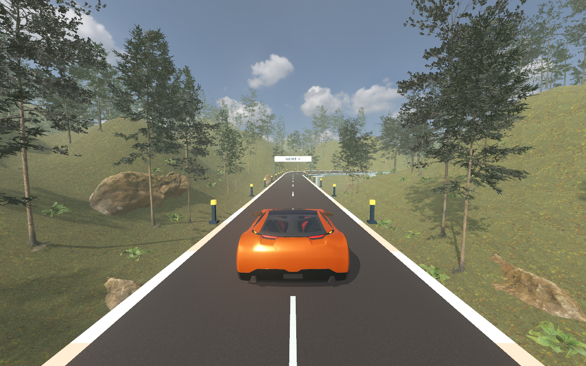

# Waldstrecke „Erste Fahrt“

Stand: 15. Oktober 2026.

Dieser Bericht beschreibt den ersten Waldentwurf vor dem Stuntumbau.
Den aktuellen Streckenverlauf beschreibt [stunt-umsetzung.md](stunt-umsetzung.md).

Die bestehende Strecke führt jetzt durch ein zusammenhängendes Waldgelände.
Sie enthält Tannen, Kiefern, moosige Felsen, Farne und Gras.
Die Hänge folgen dem Streckenverlauf.
Die Strecke bleibt 600 Meter lang.

Die Modelle stammen aus sechs kostenlosen Paketen von Poly Haven.
Die Quellen und die Lizenz stehen in [der Modellübersicht](../assets/forest/README.md).
Die Waldlandschaft nutzt eigene Dateien für das Gelände und die Anordnung der Modelle.
Damit lassen sich weitere Waldstrecken später ergänzen.

## Prüfergebnisse

- Alle 15 Godot-Prüfprogramme endeten ohne fehlgeschlagene Prüfung.
- Alle 15 Python-Prüfungen der Spracheingabe bestanden.
- Die neue Waldprüfung bestand 46 Bedingungen.
- Eine vollständige Fahrt erreichte das Ziel mit drei Richtungseingaben.
- Der Falltest bestätigte den Fall, die Bodenbegrenzung und den automatischen Neustart.
- Sechs Bilder zeigen den Beginn, die Kurven und das Ende der Strecke.
- Eine unabhängige Codeprüfung fand nach den Korrekturen keine wesentlichen offenen Fehler.

Die Prüfungen ohne Fenster meldeten eine macOS-Meldung zum Zertifikatsspeicher.
Diese Meldung hatte keinen Einfluss auf die lokalen Spielprüfungen.
Der vorhandene Vorschaubild-Lader meldet außerdem einen Hinweis für einen späteren Spieleexport.
Diese Arbeit prüft den lokalen Projektstart.

## Bildrate

Die Messung umfasst die vollständige Strecke mit 1646 Bildern.
Vor der Messung liefen 120 Bilder zum Vorbereiten der Darstellung.
Während der Messung entstanden keine Bildaufnahmen.

| Merkmal | Ergebnis |
|---|---|
| Rechner | Apple M4 Pro |
| Bildgröße | 1280 × 800 Bildpunkte |
| Grafikmodus | Forward+ mit Metal |
| Mittlere Bildrate | 50,8 Bilder pro Sekunde |
| Mittlere Bildzeit | 19,7 Millisekunden |
| Grenze für 95 Prozent der Bildzeiten | 24,3 Millisekunden |
| Fahrt | Ziel erreicht |

Diese Messung belegt keine durchgehend 60 Bilder pro Sekunde.
Andere Rechner und Bildgrößen können andere Ergebnisse liefern.
Die vollständigen Messwerte stehen in [wald-bildzeiten.json](wald-bildzeiten.json).
Die Ergebnisse der Spielprüfungen stehen in [wald-testresultate.json](wald-testresultate.json).

## Start

Starte das Spiel über `Starten.command` neu.
Wähle die Strecke „Erste Fahrt“.
Das neue Vorschaubild zeigt den Wald.

